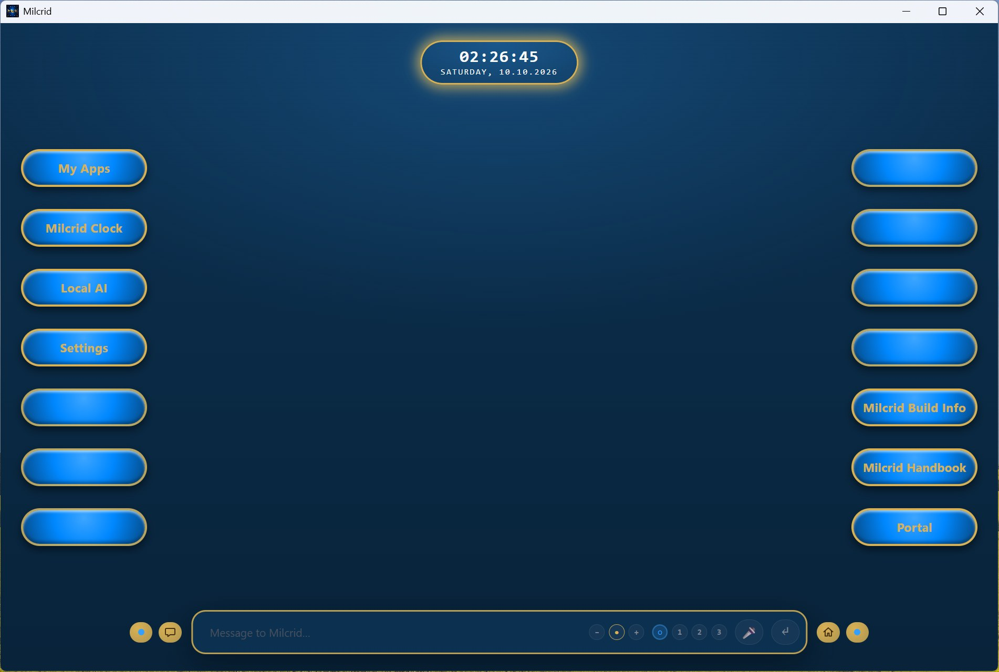
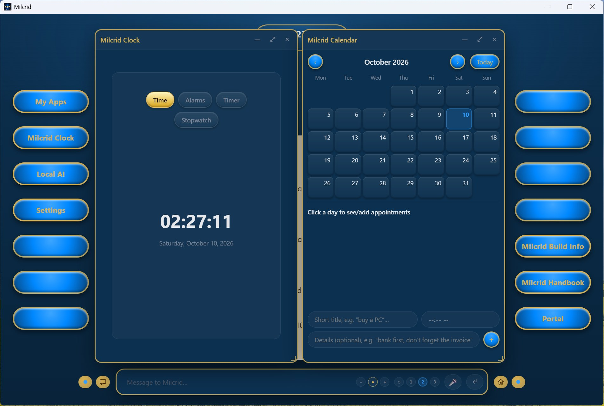
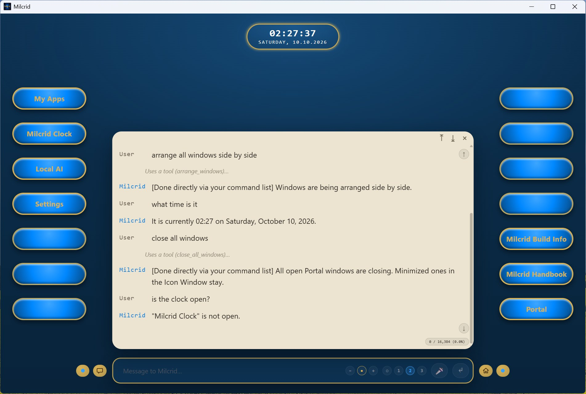

# Milcrid

**🇬🇧 [English](#english) · 🇩🇪 [Deutsch](#deutsch)**

**AI on your own PC – as an app for Windows (beta).**

> *"AI doesn't need an 'I'. It needs you for the 'we'."*

Milcrid is an app in which an AI that **runs on your own PC** works alongside you. You type or say what you want –
and it opens programs, arranges windows, enters appointments, takes notes. What you say and write stays with you.

Built by Klaus Döring together with AI as co-developer – no team, no investors.

## ⬇️ Download

**[Go to the latest version (Releases)](../../releases)** – the installer `Milcrid-Setup-<version>.exe` is there.
The step-by-step guide: **[INSTALL-WINDOWS.md](INSTALL-WINDOWS.md)**.

## Please read first

- **Milcrid is a beta.** It runs and it is tested, but it makes mistakes: the AI models that fit on a normal PC are
  small and sometimes misunderstand a sentence. That is why Milcrid checks whether the AI really did what it claims –
  and tells you if it didn't.
- **Free for private, non-commercial use**, at your own risk, without warranty.
- **Windows warns you during installation**, because this small project has no paid signing certificate. What to do
  then (also with "Smart App Control") is in the [guide](INSTALL-WINDOWS.md).

## What you need

- Windows 10 or 11 (64-bit)
- For usable speed: a graphics card with 8 GB of memory or more (NVIDIA recommended). Without one, the AI answers
  very slowly.
- About 20 GB of free disk space and an internet connection for the setup. At the first start Milcrid sets up the AI
  with you (Ollama and one model, 3–7 GB). After that the AI works without the internet.

## What Milcrid can do

- **Operate the PC by sentence:** "open the editor", "make the clock big", "arrange all windows side by side" –
  also for the windows of other programs
- **Speak instead of typing:** microphone button or wake word ("Computer, open the clock")
- **Its own apps:** clock, calculator, calendar, appointments, notes, editor, image viewer, video, sketch, trash
- **Text size to suit you** – bigger or smaller for all windows (Settings › Size), or just for one window with A− / A+
- **Updates with one click** – Milcrid shows what is new and installs the new version itself (Portal › Update)
- **File Manager and Topics** – your own collections of files and programs
- **Windows settings inside Milcrid:** volume, microphone, network, display and more – change them right in the
  Portal, or say "open the Windows settings for sound"
- **Honest AI:** for anything that cannot be undone, Milcrid asks first
- **Learning:** say "that was right", and next time Milcrid carries out that sentence immediately
- **English and German**, switchable under Settings › Language
- **Built-in handbook** – on one of the blue buttons, or say "open handbook"

| | |
|---|---|
|  |  |

## Private

The AI and the speech recognition run on your PC. Only what you explicitly ask for goes to the internet: an internet
search, the optional Online AI with your own key, and the button that looks for a new Milcrid version.

## Updates

In Milcrid under **Portal › Update › Milcrid Update**, a button looks here for a newer version – only when you click
it. A new installer replaces the program and keeps your data.

## Building your own Milcrid

Milcrid was built together with Claude, an AI by the company Anthropic. With the Claude app you can extend and
rebuild your Milcrid yourself – in plain sentences. How that works is described inside Milcrid, in the app
**Milcrid Build Info** and in the handbook. Milcrid is an independent project and is not connected with Anthropic;
Milcrid works completely without Claude.

## License

[PolyForm Noncommercial 1.0.0](LICENSE.md) – in short: **free for private, non-commercial use. Commercial use only
with permission** – just ask. (The license text is binding, not this summary.)

## Contact

Homepage: [miluh.de](https://miluh.de/) · E-mail: miluhevolution@freenet.de

---

# Milcrid – Deutsch

**KI auf deinem eigenen PC – als App für Windows (Beta).**

> „KI braucht kein Ich. Sie braucht Dich für das Wir."

Milcrid ist eine App, in der eine KI mit dir zusammenarbeitet, die **auf deinem eigenen PC läuft**. Du schreibst oder
sagst, was du möchtest – und sie öffnet Programme, ordnet Fenster, trägt Termine ein, legt Notizen an. Was du sagst
und schreibst, bleibt bei dir.

Gebaut von Klaus Döring zusammen mit KI als Mitentwickler – ohne Team, ohne Investoren.

## ⬇️ Herunterladen

**[Zur neuesten Version (Releases)](../../releases)** – dort liegt der Installer `Milcrid-Setup-<Version>.exe`.
Die Anleitung Schritt für Schritt: **[INSTALL-WINDOWS.md](INSTALL-WINDOWS.md)** (englisch).

## Bitte zuerst lesen

- **Milcrid ist eine Beta.** Es läuft und ist getestet, aber es macht Fehler: die KI-Modelle, die auf einen normalen
  PC passen, sind klein und verstehen einen Satz manchmal falsch. Milcrid prüft deshalb, ob die KI wirklich getan
  hat, was sie behauptet – und sagt es, wenn nicht.
- **Kostenlos für private, nicht-kommerzielle Nutzung**, auf eigenes Risiko, ohne Garantie.
- **Windows warnt beim Installieren**, weil dieses kleine Projekt kein bezahltes Zertifikat hat. Was dann zu tun ist
  (auch bei „Smart App Control“), steht in der [Anleitung](INSTALL-WINDOWS.md).

## Was du brauchst

- Windows 10 oder 11 (64 Bit)
- Für brauchbares Tempo: eine Grafikkarte mit 8 GB Speicher oder mehr (NVIDIA empfohlen). Ohne antwortet die KI sehr
  langsam.
- Etwa 20 GB freien Platz und Internet für die Einrichtung. Beim ersten Start richtet Milcrid mit dir die KI ein
  (Ollama und ein Modell, 3–7 GB). Danach arbeitet die KI ohne Internet.

## Was Milcrid kann

- **Den PC bedienen, per Satz:** „öffne den Editor“, „mach die Uhr groß“, „ordne alle Fenster nebeneinander an“ –
  auch für Fenster anderer Programme
- **Sprechen statt tippen:** Mikrofon-Knopf oder Codewort („Computer, öffne die Uhr“)
- **Eigene Apps:** Uhr, Rechner, Kalender, Termine, Notizen, Editor, Bildbetrachter, Video, Skizze, Papierkorb
- **Schrift so groß, wie du sie brauchst** – für alle Fenster (Einstellungen › Größe) oder nur für ein Fenster mit A− / A+
- **Updates mit einem Klick** – Milcrid zeigt, was neu ist, und installiert die neue Version selbst (Portal › Update)
- **Datei Manager und Themen** – eigene Sammlungen aus Dateien und Programmen
- **Windows-Einstellungen in Milcrid:** Lautstärke, Mikrofon, Netzwerk, Bildschirm und mehr – direkt im Portal
  schalten, oder sag „öffne die Windows-Einstellungen für Sound“
- **Ehrliche KI:** bei allem, was sich nicht rückgängig machen lässt, fragt Milcrid vorher
- **Dazulernen:** sag „das war richtig“, und Milcrid führt diesen Satz beim nächsten Mal sofort aus
- **Deutsch und Englisch**, umschaltbar unter Einstellungen › Sprache
- **Handbuch eingebaut** – auf einem der blauen Knöpfe, oder sag „öffne Handbuch“

## Privat

Die KI und die Spracherkennung laufen auf deinem PC. Ins Internet geht nur, was du ausdrücklich verlangst: eine
Internetsuche, die zuschaltbare Online-KI mit deinem eigenen Schlüssel, und der Knopf, der nach einer neuen
Milcrid-Version sieht.

## Updates

In Milcrid unter **Portal › Update › Milcrid Update** sieht ein Knopf hier nach einer neueren Version – nur wenn du
klickst. Ein neuer Installer ersetzt das Programm und lässt deine Daten stehen.

## Dein eigenes Milcrid bauen

Milcrid ist zusammen mit Claude entstanden, einer KI der Firma Anthropic. Mit der Claude-App kannst du dein Milcrid
selbst erweitern und umbauen – in normalen Sätzen. Wie das geht, steht in Milcrid in der App **Milcrid Bau-Info** und
im Handbuch. Milcrid ist ein unabhängiges Projekt und nicht mit Anthropic verbunden; Milcrid funktioniert vollständig
ohne Claude.

## Lizenz

[PolyForm Noncommercial 1.0.0](LICENSE.md) – kurz gesagt: **frei für private, nicht-kommerzielle Nutzung.
Kommerzielle Nutzung nur mit Erlaubnis** – einfach fragen. (Maßgeblich ist der Lizenztext, nicht diese
Zusammenfassung.)

## Kontakt

Homepage: [miluh.de](https://miluh.de/) · E-Mail: miluhevolution@freenet.de
